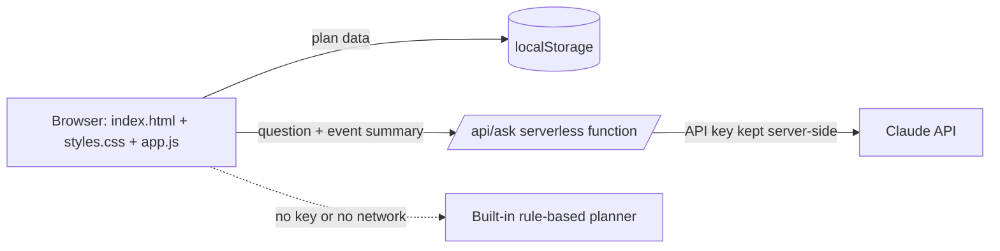

# UTSAV AI

**Every celebration deserves a perfect plan.**
UTSAV AI is a celebration and event planner for weddings, birthdays and community events. Enter a few details and it builds a budget, a dated timeline, a vendor checklist, an illustrated visual plan and a what-if simulator, with an AI assistant for follow-up questions.

**Live demo:** `<add your deployed URL here>`
**Source:** `<add your GitHub repository URL here>`

---

## The problem

Planning a celebration is stressful and easy to get wrong. People overspend because the budget is never broken down, miss deadlines because nobody dates the tasks, and struggle to picture a theme before they pay for it. Most planning tools are either generic to-do lists or paid services built for professionals.

## The solution

UTSAV AI turns four inputs (event type, date, budget, guest count) plus optional priorities into a complete, editable plan that works on a phone:

- a **budget split** you can edit, with live over-budget alerts;
- a **timeline dated backwards from the event day** that compresses when the event is close;
- a **vendor and resource checklist** with your own status and notes;
- an **illustrated visual plan** (mood board, décor concept, table styling, seating layout, schedule, budget chart);
- a **what-if simulator** to preview changes in budget or guest count before applying them;
- an **AI planning assistant** for questions such as "How can I save money?" or "What if 20 more guests attend?".

## Features

| Tab | What it does |
| --- | --- |
| Overview | Theme, décor, food and activity ideas, event-day schedule, risks. Download the plan as Markdown. |
| Visual plan | Six generated illustrations tailored to the event type, theme colours, guest count and budget. Download as HTML. |
| Budget | Editable planned and actual amounts per category, utilisation, over-budget alert, reset to the suggested split. |
| Timeline | Tasks dated from the event date, status tracking, overdue badges, filters, custom tasks. |
| Checklist | Suggested / contacted / confirmed status per resource, notes, custom items. |
| What-if simulator | Side-by-side original vs proposed budget and guest count, lower-cost ideas, rain contingency, apply or discard. |
| AI assistant | Chat about your plan. See "AI services" below for exactly how answers are produced. |

## AI services and how they are actually used

Be precise about what is AI and what is not:

- **Plan generation is deterministic.** The budget split, timeline, checklist, schedule and visuals come from templates and arithmetic in `app.js`. No AI model is called to build them.
- **The AI assistant uses Claude (Anthropic) when a live connection exists**, in this order:
  1. **Claude runtime inside claude.ai** (only when the page is opened as a Claude artifact).
  2. **Server proxy** `POST /api/ask`, a small serverless function (`functions/ask.js`) that calls the Anthropic Messages API. It needs an `ANTHROPIC_API_KEY` environment variable on the host. The default model is `claude-haiku-5-5` and can be changed with `ANTHROPIC_MODEL`.
  3. **Built-in rule-based planner** (`localAnswer` in `app.js`). It answers from the user's own plan data with keyword matching. It is **not** an AI model. Every reply is labelled either "UTSAV AI · Claude" or "UTSAV AI · planner" so the user always knows which one answered.
- **What is sent to Claude:** event type, date, days left, guests, budget, theme, planning style, priorities, budget allocations and up to 8 open tasks, plus the last 8 chat turns. **The event name, location and notes are never sent.**
- If no API key is configured on the deployment, step 2 is skipped and the built-in planner answers.

## Architecture



- Static front end, no framework and no build step. Everything the plan needs runs in the browser.
- The only server code is `functions/ask.js` (one small file), used only for the AI assistant.
- Data stays in the user's browser (`localStorage`). There are no accounts and no database.

## Tech stack

HTML, CSS and vanilla JavaScript (ES2020) · inline generated SVG illustrations · Google Fonts (Cormorant Garamond, Mulish) · Netlify Functions (Node 18+) for the optional AI proxy · Node's built-in test runner (`node --test`), no dependencies.

## Project structure

```
index.html        page shell and Content-Security-Policy
styles.css        pastel light theme, responsive layout
app.js            all application logic, templates, illustrations, assistant
functions/ask.js  optional serverless proxy to the Claude API
app.test.js       automated tests (npm test)
netlify.toml      Netlify build, /api/ask route and security headers
package.json      scripts only, no dependencies
.env.example      names of the environment variables (no real values)
```

## Run locally

Requirements: Node.js 18 or newer (only needed for tests and a local server).

```bash
git clone <your-repo-url>
cd utsav-ai
npx serve .          # then open the printed address, or just open index.html in a browser
npm test             # runs the automated tests
```

Without an API key the assistant uses the built-in planner. To try the live AI locally, install the Netlify CLI (`npx netlify dev`) and put your key in a local `.env` file (see `.env.example`). Never commit `.env`.

## Deploy

**Netlify (supports the AI function):** import the GitHub repository, leave the build command empty (settings come from `netlify.toml`), then add `ANTHROPIC_API_KEY` under Site configuration → Environment variables and redeploy.

**GitHub Pages (static only):** Settings → Pages → Deploy from a branch → `main` / root. The app works fully; the assistant uses the built-in planner because Pages cannot run the function.

## Testing

`npm test` runs 20 automated tests against the real `app.js` and `functions/ask.js`, including:

- budget allocations are whole rupees and add up exactly for all three event types, many budgets and priority combinations;
- a priority moves money toward that category; task dates never fall after the event;
- the what-if simulator never goes negative or over the new budget;
- saved data survives a reload, and tampered or corrupted `localStorage` is rejected;
- every page renders without `undefined` or `NaN`, and all 90 illustrations are well-formed SVG;
- the built-in planner answers every suggested question with the user's own numbers;
- the assistant's fallback order (Claude runtime, server proxy, built-in planner) and that private fields are never sent;
- the serverless function rejects wrong methods, missing keys, cross-origin calls, bad and oversized input, never returns the key, and strips unknown fields.

Not covered by automated tests: the real Claude API (needs a key), visual appearance, and screen readers. A manual checklist for the deployed site is in the submission notes.

## Security

- All user text is HTML-escaped before it is rendered; there are no inline event handlers.
- A strict **Content-Security-Policy** limits scripts to the site's own files and network calls to the same origin.
- Saved data is **validated on load** (types, ranges, allowed values); invalid data is ignored instead of rendered.
- The API key lives only in the host's environment variables, never in the repository or the browser. `.gitignore` excludes `.env` files.
- The function accepts only same-origin POSTs, limits request size (16 KB), message count and length, whitelists event fields, caps output at 450 tokens and times out after 20 seconds.
- Security headers (`nosniff`, `no-referrer`, frame denial) are set by `netlify.toml`.

## Accessibility and responsiveness

Mobile-first layout, verified for no horizontal scrolling at 390, 820 and 1280 px wide. Form fields have labels and inline errors; tabs and controls are at least 44 px tall and keyboard-focusable with a visible focus ring; status changes are announced through a live region; illustrations have text labels; the page title updates per view.

## Assumptions

- Amounts are in Indian rupees and are **illustrative estimates**, not vendor quotes. Category percentages are sensible defaults, not market data.
- Budget priorities shift a few percentage points between categories.
- A "table" seats 8 guests.

## Limitations

- Plan generation is template-based, not generative AI. Only the assistant can use an AI model.
- The deployed assistant uses Claude only if the host has a valid API key. The function has not been load-tested and has no per-user rate limiting, so set a spend limit on the key.
- Data is stored per browser. Clearing site data deletes the plan; there is no sync or sharing.
- The app never contacts vendors, books anything, or checks weather.
- Visuals are generated concept illustrations, not photographs or real vendor work.
- English only. Fonts load from Google Fonts and fall back to system fonts if blocked.
